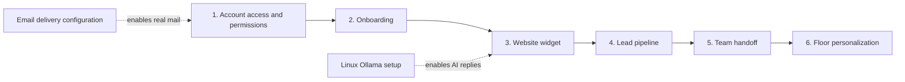

# Agent Meadow — Milestone 3 implementation plan

Status: **Plan for review. Implementation has not started.**  
Prepared: **2026-11-13**  
Scope: all six workstreams requested by the user. This plan does not authorize a paid service, send email, reset an account, or change the live app.

## Outcome

Make Agent Meadow easier to access, onboard, publish on client websites, and operate day to day. Keep the hybrid service model: the platform owner manages agent configuration and publication, while business users operate within their own business permissions.

The existing original Meadow Commons design remains the basis of floor personalization. No external floor implementation or artwork is needed.

## Starting point

- Milestones 1 and 2 are live: tenant isolation, accounts, agents, knowledge/citations, contact capture, human handoff, original floor, and PWA support.
- The complete test baseline is **49 passing backend tests**. These are existing results; no tests were run merely to write this plan.
- Public signup creates isolated client businesses; there is no email verification or email-based recovery yet.
- Clients currently have limited dashboard rights; platform administrators configure agents and handle human replies.
- Chat is currently an authenticated dashboard playground. There is **no public website widget**.
- Handoff and leads exist, but staff assignment, per-user unread notifications, and pipeline stages do not.
- Floor appearance is fixed; statistics come from real business data.
- Ollama is still disconnected. Its Linux setup can proceed independently. Human support, consented contact collection, and most of this milestone can be built without a working model.

## Build order and completion gates

| Phase | Deliverable | Complete when |
|---|---|---|
| 1 | Account recovery, verified email, permission foundation | Expiring single-use links work, password reset revokes sessions, and business permissions are enforced without breaking existing accounts |
| 2 | Business onboarding wizard | A client can save and resume its business setup, submit it, and an administrator can review and publish the approved configuration |
| 3 | Website chat widget | An approved widget embeds on an allowed website, isolates visitors, and supports human-only operation when AI is unavailable |
| 4 | Lead pipeline | Authorized users can manage stages, notes, follow-up dates, search/filter, and export only their business's leads |
| 5 | Team handoff management | Authorized staff can claim/assign conversations and see accurate unread/assignment notifications within their business |
| 6 | Floor personalization | Authorized users can save an original layout, station order, labels, and permitted colors/icons without changing real status metrics |

Release in three reviewable groups: **A: phases 1–2**, **B: phases 3–4**, **C: phases 5–6**. Each phase gets its own acceptance checks and migration review. An unfinished external connection must not be reported as complete merely because its adapter is implemented.

## Shared foundations

### Tenant permissions

Preserve the global `admin`/`client` distinction. Add explicit business memberships for operational rights:

| Business role | Intended rights |
|---|---|
| Viewer | View the permitted business dashboard, conversations, leads, and floor |
| Responder | Viewer rights plus permitted human replies and handoff handling |
| Manager | Responder rights plus business onboarding, lead operations, floor customization, and permitted staff assignment |
| Platform administrator | Manage businesses, grant scoped roles, configure/publish agents, and administer the platform |

Existing client accounts migrate to Viewer unless the platform owner explicitly grants additional rights. A future new-business signup may create its founding business membership as Manager **only for the new business created in that transaction**; callers cannot choose a business or privileged role. This is an intentional new onboarding policy to review before implementation.

Model keys, platform roles, and agent publication remain owner-controlled. Shared authorization helpers and tenant-bearing foreign keys must be implemented before broadening any existing client endpoint.

### Data and deployment

- Add versioned Alembic migrations after `0004`, with safe defaults/backfills for existing records.
- Use tenant-scoped tables/queries and composite foreign keys for related resources.
- Use transactional changes and idempotent operations where retries could duplicate data or invitations.
- Keep existing sessions, businesses, agents, conversations, and leads usable during compatible rolling releases.
- Keep the single Free Render service and current PostgreSQL setup. No new paid worker, Redis, queue, or scheduler is required for this plan.
- Keep private API data out of PWA caches. No credentials, reset links, or visitor transcripts belong in the service-worker cache.

## Phase 1 — account recovery and verified email

### User experience

Add Forgot password, reset password with confirmation, verify email, resend verification, and clear account-status messages. Preserve existing password-change and sign-out-everywhere screens.

If email delivery is unavailable, show that accurately. Never tell a user that recovery mail was sent when the system has no delivery provider. Do not lock existing administrators out merely because a new verification field is initially empty.

### Backend and data

- Add `email_verified_at` and account-disabled state, plus a digest-only action-token table with purpose, user, expiry, and consumption timestamp.
- Reset tokens expire after 30 minutes; verification tokens after 24 hours. Generate strong random tokens, consume them atomically once, and invalidate superseded tokens.
- Successful reset changes the Argon2id hash and revokes all existing sessions. Never reopen the one-time owner claim.
- Use generic recovery responses, bounded resend/reset attempts, and server-configured application URLs; do not construct security links from an untrusted Host header.
- Deliver links with the secret in a fragment handled by the frontend, then submit it in a protected request body. Do not log raw tokens or store them in an unencrypted mail outbox.
- Add an HTTPS email-delivery adapter, with a test mailbox adapter for automated tests. Render Free blocks common outbound SMTP ports, so ordinary SMTP on 25/465/587 must not be the hosting assumption.
- Record delivery success/failure metadata without raw passwords, token bodies, or complete recovery links. Failed delivery requires a new controlled request, not an unbounded background retry loop.
- Provide account disabling with session revocation and a guard against disabling the final active platform administrator.

Planned API families: `/auth/password/forgot`, `/auth/password/reset`, `/auth/email/verify`, `/auth/email/resend`, and administrator account-management routes.

### Acceptance

Expired, replayed, wrong-purpose, and concurrent token attempts fail safely. Reset does not alter another account or tenant. Public responses do not reveal account existence. Existing account access remains compatible. Test delivery is kept separate from a real inbox verification.

**External dependency:** choose a provider with an acceptable free HTTPS allowance and configure its credentials/verified sender privately. Free delivery quotas and sender/domain requirements must be checked before choosing it. No purchase or message sending is part of this planning task.

## Phase 2 — business onboarding wizard

### User experience

A resumable checklist collects business profile, contact details, services/FAQs, handoff preferences, and a preferred starter template. Initial templates: General reception, Customer support, and Lead qualification.

Clients save drafts and submit them for review. The platform administrator can review changes, request corrections, create/configure the agent, and publish the approved setup. Show a useful incomplete-setup dashboard rather than empty unexplained panels.

### Backend and data

- Add a tenant-scoped onboarding draft with version/status: Draft → Submitted → Changes requested or Approved → Published.
- Separate draft information from active agent prompts and knowledge. A client submission must not silently change a running agent.
- Validate contact fields and document limits. Reuse the existing plain-text/Markdown knowledge flow; PDF, crawling, and external URL ingestion are outside this first slice.
- Publish approved agent/knowledge changes transactionally and prevent duplicate starter agents when a submit/publish request is retried.
- Keep agent template versions so an update does not silently rewrite an existing client agent.

Planned API families: `/businesses/{id}/onboarding`, `/onboarding/submit`, `/onboarding/review`, and `/onboarding/publish`.

### Acceptance

Drafts survive sign-out/refresh and can be resumed. Clients cannot read another business's drafts or publish agent changes. Repeated publication is idempotent. A setup can be previewed with a test-only provider; live model activation remains a separate, explicit check.

## Phase 3 — website chat widget

### User experience

Provide a copy/paste embed snippet, mobile-friendly launcher/panel, business branding, consented contact form, request-a-person action, and conversation status. Supply installation instructions and a preview.

Support a clearly labelled **human-support mode** while AI is unavailable. An off/disconnected model must not cause fake AI replies or claims that a person has already responded. Visitors can leave a message for the real handoff inbox.

### Publication and visitor boundaries

- Publish only an administrator-approved agent and explicitly approved knowledge documents. Internal tenant documents must not become public merely because a widget is enabled.
- Resolve widget → business/agent on the server using an opaque public installation ID. That ID is not a secret or a dashboard credential.
- Give each visitor an opaque, short-lived conversation credential, stored as a digest server-side. Reads/replies require that visitor credential; public conversation IDs alone grant no access.
- Scope visitor sessions, messages, leads, and handoffs to the widget's business. Never accept client-selected business IDs, staff roles, or arbitrary agent IDs.
- Keep dashboard sessions separate from anonymous visitor access. Do not rely on third-party cookies for widget operation.
- Limit credential persistence to what is needed for a visitor session; no transcript caching in service-worker Cache Storage. Define refresh/expiry behavior and test browsers that restrict third-party storage.
- Validate embed configuration and postMessage sender/source. Expose no provider keys, session secrets, or internal dashboard data to the embedding site.
- Use an embedding-origin allowlist and widget-specific `frame-ancestors` policy. Preserve the dashboard's frame protection. An origin allowlist is a browser embedding control, not proof that a raw HTTP client is trusted.
- Apply per-widget, visitor, business, message-size, context, concurrency, and inference limits. Enforce limits before model calls. Add session/message idempotency for retries.
- Require a verified publisher and an approved installation before enabling a public widget. Include an immediate disable/revoke control.

Planned API family: a dedicated `/widget-api` visitor surface and `/businesses/{id}/widgets` management routes. Implement a dedicated Next.js proxy/route boundary rather than broadly relaxing the existing dashboard Origin checks or CORS policy.

### Acceptance

Test two businesses, multiple installations, and two visitors on the same installation: none can read another visitor/tenant transcript. Revocation and session expiry work. Test allowed/disallowed embedding sites, postMessage handling, mobile, keyboard use, AI-off/human-only operation, and Render cold starts. A Free sleeping service cannot be advertised as always instant.

## Phase 4 — lead pipeline

### User experience

Add New, Contacted, Qualified, and Closed stages; filters/search; lead detail; timestamped notes; follow-up dates; linked conversation; and CSV export. Stage changes are available by keyboard and standard buttons; drag-and-drop is optional enhancement.

### Backend and data

- Backfill existing leads to New without changing their names, contact information, source, or conversation linkage.
- Add tenant-scoped append-only notes and stage-change history with actor and timestamp.
- Allow Managers/authorized operators to manage leads; preserve read-only viewers.
- Keep chat capture behind explicit consent and existing deduplication. Capture source and consent metadata appropriate to the widget.
- Calculate due/overdue indicators when viewed; do not promise scheduled email delivery or create a paid scheduler.
- Paginate/filter at the database layer. Protect CSV against spreadsheet formula injection and export only authorized fields/rows.

Planned API families: lead detail/update, notes/history, and scoped `/leads/export`.

### Acceptance

Old lead data survives migration, stage transitions persist, unauthorized updates fail, filters and dates behave consistently, and CSV export cannot leak another business or execute spreadsheet formulas.

## Phase 5 — team handoff management

### User experience

Add unassigned/mine/all views, explicit staff assignment, claim/release, unread indicators, a notification bell, and clear human-handling/resolution status. Notify authorized staff in-app about new handoffs, assignments, and replies.

### Backend and data

- Build on Phase 1 memberships. Assign only users authorized for the conversation's business; a display label is never permission.
- Add tenant-scoped assignment/history and per-user read cursors. Define how platform administrators are represented for assignment without granting ordinary clients global access.
- Prevent simultaneous claims from silently replacing each other using transactional locking/version checks.
- Mark reads explicitly; opening a list must not mark every conversation read. Filter notification contents by the recipient's current authorization.
- Create in-app notifications in the same transaction as the relevant event, with deduplication. Handle role removal/disabled accounts safely.
- Use on-demand/focus refresh and optional conservative polling while the relevant screen is visible. No always-on worker or fabricated typing/presence is required.
- Email alerts and browser push remain disabled unless separately selected/configured. The first release is in-app notification delivery.

Planned API families: conversation assignment/claim/release/read, business members, and current-user notification list/read actions.

### Acceptance

Concurrent claims produce one owner or an explicit conflict. Staff cannot claim/read/reply outside their business. Viewers cannot impersonate responders. Read/unread counts are correct per user, and notifications do not expose removed or cross-tenant access.

## Phase 6 — floor personalization

### User experience

Allow permitted names/purpose labels, a curated color/icon palette, station placement/order, and a choice of original layouts. Preserve Meadow Commons and add an original Orchard Ring layout. Support reset-to-default and keyboard controls alongside pointer interactions.

### Backend and design

- Store per-business floor configuration with a version, layout choice, and validated station assignments. Clients with floor-management permission can customize only their business; agent publication/model secrets stay owner-controlled.
- Snap moves to valid stations; reject duplicate occupancy and foreign-business agent IDs. Include conflict handling for two editors.
- Use approved icons/colors, plain labels, and normalized layout values. Do not accept arbitrary HTML, SVG uploads, or executable CSS.
- Separate agent purpose labels from user permission roles.
- Keep actual enabled/paused state, messages, token totals, and handoff alerts authoritative. Cosmetic settings cannot fabricate work or override an operational status.
- Preserve the accessible list view, mobile behavior, and reduced-motion support. No external floor assets or WebGL dependency is required.

Planned API family: `/businesses/{id}/floor/settings` and reset action, using the existing `/floor` metrics endpoint.

### Acceptance

Layouts persist across devices and business switching. Foreign agent references fail. Colors remain readable, keyboard placement works, simultaneous edits are handled, and returning to the default preserves real agent/conversation data.

## Migration and release strategy

Use separate, reviewed migrations for these domains, likely starting at `0005`; choose final revision identifiers during implementation. Test upgrade/backfill using existing data and verify PostgreSQL changes on an isolated branch before production.

Each release group requires relevant authentication/tenant-isolation tests, API integration tests, browser flows at desktop/mobile sizes, production build/type checks, and inspection of any public data boundary. Do not add tests that only repeat an implementation expression; test behavior and failure cases.

Before calling a release live, record the actual commit, deployment status, schema revision, and verified behaviors in `PROGRESS.md`. Never count mocked email delivery, a test model server, or prepared configuration as a successful real integration. Keep current UI/API behavior compatible during migration rollout and test the real cold-start/offline behavior that free hosting introduces.

## Dependencies and review decisions

| Decision / dependency | Recommended starting position |
|---|---|
| Email delivery | HTTPS adapter with a separately configured free allowance; no provider chosen or paid plan assumed |
| Existing accounts | Keep sign-in working; migrate verification state honestly and require verification for new public-publishing privileges |
| Client permissions | Viewer/Responder/Manager scoped to business; platform admin retains agent configuration/publication |
| Onboarding | Clients submit, owner reviews and publishes |
| Widget launch | Human-support mode can ship before Ollama; approved public agent/knowledge and visitor isolation are mandatory |
| Lead permissions | Managers/authorized operators edit; Viewers read |
| Notifications | In-app first; no automatic external messages or new paid workers |
| Floor design | Original Meadow Commons plus original Orchard Ring; actual 3D is deferred |
| Linux inference | Independent task; still needs the user's machine, HTTPS bridge endpoint, and private Render configuration |

## Implementation checklist

- [x] Inspect current application and progress record.
- [x] Document all six workstreams, their sequence, permissions, dependencies, and acceptance criteria.
- [ ] Review this plan with the user before implementation.
- [ ] Implement/review Release A: account access and onboarding.
- [ ] Implement/review Release B: widget and lead pipeline.
- [ ] Implement/review Release C: team handoff and floor personalization.
- [ ] Complete real integration checks where external services/hardware are required.

No application code, production configuration, database schema, account credentials, or live deployment was changed to produce this plan.
